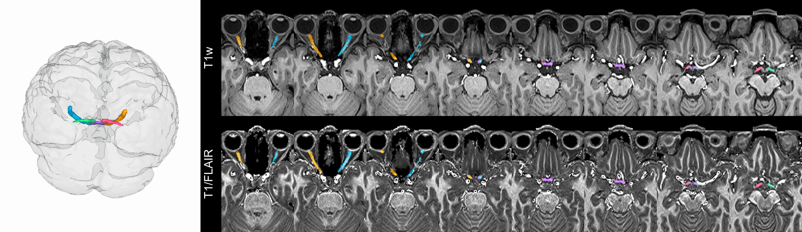
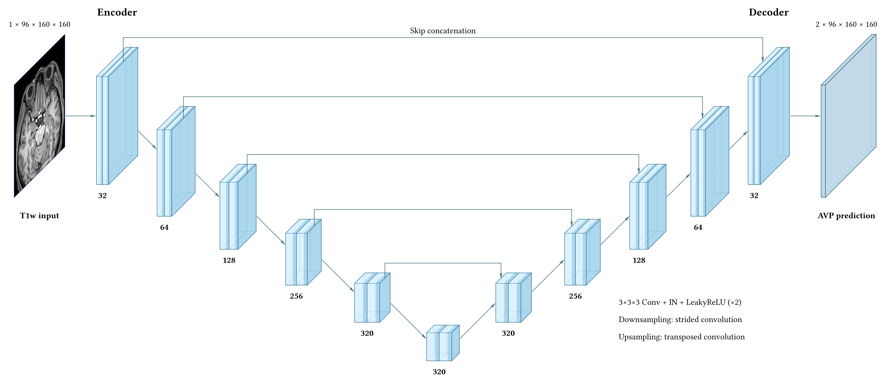

# AVP Segmentation



Segment the anterior visual pathway and measure the optic nerves from T1-weighted MRI.

## Install

In WSL/Ubuntu, activate a Python 3.9+ environment and run from the repository root:

```bash
bash install.sh
```

Model weights will be released after the associated paper is accepted for publication.

Place the five model weights, `fold0.pth` through `fold4.pth`, in `models/v1/`. Check the installation and model files:

```bash
avp_seg_doctor
```

## Run

With [FreeSurfer SynthSeg](https://surfer.nmr.mgh.harvard.edu/fswiki/SynthSeg) configured, generate labels from your T1w image:

```bash
mri_synthseg --i T1w.nii.gz --o synthseg.nii.gz --keepgeom
```

[`--keepgeom`](https://github.com/freesurfer/freesurfer/blob/dev/mri_synthseg/mri_synthseg) saves the labels on the input T1w's original voxel grid, preserving its dimensions and affine. Use that same T1w for AVP segmentation:

```bash
avp_seg T1w.nii.gz synthseg.nii.gz output_dir
```

Open `output_dir/qc.html` to review the result. The same directory contains:

- `avp_mask.nii.gz` and `avp_prob.nii.gz`: AVP mask and probability map.
- `avp_5label.nii.gz`: left/right optic nerves, optic chiasm, and left/right optic tracts.
- `optic_nerve_metrics.xlsx`: optic nerve measurements.

Add `--overwrite` to rerun in an existing output directory. Run `avp_seg --help` for all options.

## Model

A six-stage 3D U-Net configured with nnU-Net, using five-fold ensemble inference.


